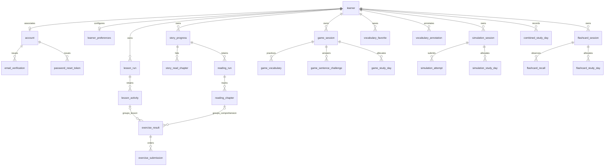

# Learner domain and PostgreSQL design

V1 creates the application namespace. V2 installs the relational model in `mellow`. V3 adds catalog revisions and immutable session evidence to the existing session tables. V4 adds revisions and removal markers to personal resources. V5 adds legacy import receipts and support for preserving separate historical snapshots. V6 adds accounts and email verification. V7 adds password reset tokens and account security revisions. The model records learner ownership, retained progress, practice sessions and duration evidence. Authored content remains in the frontend catalog. No rows are seeded.

## Entity relationships

An exercise result belongs to exactly one lesson activity or reading chapter. Direct ownership uses a foreign key to `learner.id`. Rows below an aggregate have one parent and inherit its owner. The SQL has ordinary foreign key enforcement, with restrictive deletion defaults. The session boundary verifies the account and learner pair before the application scopes access to that learner.

## Tables and columns

Unless specified as nullable, columns described below are required. Most existing UUID primary keys default to `gen_random_uuid()` in SQL. For V6, the application assigns the account UUID and Hibernate generates the verification UUID. Child collections use composite keys. Catalog and legacy references are case-sensitive nonblank text. Counters and milliseconds use `bigint` where the browser stores a safe integer. Positions within ordered arrays use zero-based `integer`. Typed states are readable text with check constraints.

| Table                                                           | Columns, keys and constraints                                                                                                                                                                                                                                                                                                                                                                                                                                                                                                                                        |
| --------------------------------------------------------------- | -------------------------------------------------------------------------------------------------------------------------------------------------------------------------------------------------------------------------------------------------------------------------------------------------------------------------------------------------------------------------------------------------------------------------------------------------------------------------------------------------------------------------------------------------------------------- |
| `learner`                                                       | `id uuid` PK, `created_at timestamptz` defaults to current time. Identity has no credential or default account.                                                                                                                                                                                                                                                                                                                                                                                                                                                      |
| `learner_preferences`                                           | `learner_id uuid` PK/FK, `reading_font_size text` normal/large/extra large, `show_reading_translations boolean` and `updated_at timestamptz`. Defaults are normal, false and current time. Optional row per learner.                                                                                                                                                                                                                                                                                                                                                 |
| `lesson_run`                                                    | `id uuid` PK, `learner_id uuid` FK, `lesson_ref`, `run_ref`, `block_ref` text, `current_run`, `completed`, `first_completion` boolean, nullable `started_at` and `finished_at timestamptz`, nullable `finished_on date`, `visited_block_refs text[]`, `active_ms bigint`. Unique learner/lesson/run and partial uniqueness for current and first completion per learner/lesson. First completion implies completion, ending evidence belongs to completed runs, and known instants are chronological.                                                                |
| `lesson_activity`                                               | `id uuid` PK, `run_id uuid` FK, `block_ref` and `activity_ref` text, `finished boolean`, `text_activity_refs` and `heard_activity_refs text[]`. Unique run/block.                                                                                                                                                                                                                                                                                                                                                                                                    |
| `story_progress`                                                | `id uuid` PK, `learner_id uuid` FK, `story_ref text`, `lifetime_active_ms bigint`. Unique learner/story.                                                                                                                                                                                                                                                                                                                                                                                                                                                             |
| `story_read_chapter`                                            | Composite PK `(story_progress_id, chapter_ref)`, FK to the story aggregate, `chapter_ref text`, optional verified `read_on date`. Membership records lifetime completion independently of the date.                                                                                                                                                                                                                                                                                                                                                                  |
| `reading_run`                                                   | `id uuid` PK, `story_progress_id uuid` FK, `run_ref` and `chapter_ref` text, `current_run` and `first_completion` boolean, nullable `started_at` and `completed_at timestamptz`, nullable `completed_on date`, `active_ms bigint`. Unique story/run and partial uniqueness for current and first completed run. Completion evidence is scoped to that first milestone and exact instants are chronological when known.                                                                                                                                               |
| `reading_chapter`                                               | `id uuid` PK, `run_id uuid` FK, `chapter_ref text`, optional `paragraph_ref text`, `read_at timestamptz`, `practice_index bigint` and `practice_finished boolean`. Unique run/chapter. Both practice fields are present or absent together.                                                                                                                                                                                                                                                                                                                          |
| `exercise_result`                                               | `id uuid` PK, nullable `lesson_activity_id` and `reading_chapter_id` UUID FKs with exactly one required, `exercise_ref text`, optional `draft jsonb`, `result_status text`, nullable `reviewed_at timestamptz`. Unique per actual parent and exercise. Only reviewed state has a review instant. A non-editing state requires an answer.                                                                                                                                                                                                                             |
| `exercise_submission`                                           | Composite PK `(exercise_result_id, position)`, FK to result, `answer jsonb`, `correct boolean`, `submitted_at timestamptz`, `mode text` (practice, listening, text alternative or no audio).                                                                                                                                                                                                                                                                                                                                                                         |
| `game_session`                                                  | `id uuid` PK, `learner_id uuid` FK, `session_ref`, `game_kind`, `level`, `difficulty` text, `started_at` and `completed_at timestamptz`, `active_ms`, `answered_count`, `correct_count bigint`. Type-specific nullable fields are `vocabulary_source` and `sentence_topic` text, plus `first_attempt_correct`, `rounds_completed`, `total_pairs` and `incorrect_attempts bigint`. A discriminant check requires the fields for the selected game and omits the other variants. Correct/answered counts, first-attempt counts and Memory Game arithmetic are checked. |
| `game_vocabulary`                                               | Composite PK `(game_session_id, position)`, FK to game, `vocabulary_ref text`, optional `review_position integer`. Unique vocabulary and unique review positions per session. The optional position preserves Word Match review list order.                                                                                                                                                                                                                                                                                                                          |
| `game_sentence_challenge`                                       | Composite PK `(game_session_id, position)`, FK to game, `challenge_ref text`, `reviewed boolean`, `incorrect_answers text[]`. Unique challenge per session. Reviewed challenges require a nonempty answer history.                                                                                                                                                                                                                                                                                                                                                   |
| `simulation_session`                                            | `id uuid` PK, `learner_id uuid` FK, `session_ref`, `situation_ref`, `scenario_ref` text, `started_at` and `completed_at timestamptz`, `active_ms`, `decisions_completed`, `reviewed_corrections bigint`. Positive decision count and bounded reviewed corrections.                                                                                                                                                                                                                                                                                                   |
| `simulation_attempt`                                            | Composite PK `(simulation_session_id, position)`, FK to simulation, `node_ref`, `choice_ref`, `fit` text. Fit distinguishes appropriate, contextual and language-use responses.                                                                                                                                                                                                                                                                                                                                                                                      |
| `vocabulary_favorite`                                           | `id uuid` PK, `learner_id uuid` FK, `vocabulary_ref text`, nullable `saved_at timestamptz` or `saved_on date`. Unique learner/contextual vocabulary reference.                                                                                                                                                                                                                                                                                                                                                                                                       |
| `vocabulary_annotation`                                         | `id uuid` PK, `learner_id uuid` FK, `vocabulary_ref text`, nullable `note`, `personal_example`, `familiarity` text. At least one study field is present. `created_at` and `updated_at timestamptz` default to current time, with update no earlier than creation. Unique learner/vocabulary. Limits match the browser's 1,200 and 400 UTF-16 code-unit budgets.                                                                                                                                                                                                      |
| `flashcard_session`                                             | `id uuid` PK, `learner_id uuid` FK, `session_ref text`, `started_at` and `completed_at timestamptz`, `active_ms bigint`, `direction` and `review_scope` text, nullable `requested_length integer` (5, 10, 20 or null for all), nullable `filter_source`, `filter_type`, `filter_level`, `filter_familiarity` text, `used_search boolean`.                                                                                                                                                                                                                            |
| `flashcard_recall`                                              | Composite PK `(flashcard_session_id, position)`, FK to review, `vocabulary_ref`, `direction`, `rating` text. Unique vocabulary per session. Ratings are self-assessments.                                                                                                                                                                                                                                                                                                                                                                                            |
| `game_study_day`, `simulation_study_day`, `flashcard_study_day` | Composite PK `(session_id, study_on)` with FK to the corresponding module, `study_on date`, `active_ms bigint`.                                                                                                                                                                                                                                                                                                                                                                                                                                                      |
| `combined_study_day`                                            | Composite PK `(learner_id, study_on)` with FK to learner, `study_on date`, `active_ms bigint`. Stores the browser's already-combined lesson and reading ledger.                                                                                                                                                                                                                                                                                                                                                                                                      |

The completed game, simulation and flashcard tables have `UNIQUE (learner_id, session_ref)` within each module, ordered start/completion instants and nonnegative durations. Order positions and duration counters must be nonnegative, with positive counts required for some completed formats. SQL permits exact, date-only or unknown completion evidence where the source model can retain an undated milestone. For completed game, simulation and flashcard envelopes, the current validated formats require both instants.

Primary and unique keys create their supporting indexes. Child keys and unique constraints lead with their parent FK. Additional indexes are four partial unique indexes for the current and first lesson/reading runs and three chronological history indexes on `(learner_id, completed_at DESC, id)`. These support owner-first retrieval and deterministic timestamp ties. No separate projection tables store timelines or calculated proficiency.

## Persistence, result semantics and dates

The Java persistence packages use explicit entity fields, lazy parent associations, ordered embedded children and keyed duration collections. Repository reads for owned aggregates include the learner key. Leaves are persisted with their parent context. Future application services should load collections within a transaction and map to DTOs. SQL foreign keys use restrictive deletion defaults. Hibernate manages the lifecycle of embedded collections if their parent is explicitly removed. Deleting a learner or aggregate with dependent data requires an explicit, authorized operation and deliberate child and retention decisions. Deleting a favorite only deletes that relation. Notes and review history remain independent and re-saving the same contextual ID reconnects the Notebook view.

`timestamptz` maps to Java `Instant`, preserving absolute browser milliseconds. `date` maps to `LocalDate` without converting midnight into a completion timestamp. Daily keys retain the calendar under which the browser measured activity. The historical source does not identify which time zone produced a daily key. Future writers should define the learner-local zone at recording time and preserve it separately from display-zone conversion. Known timestamp values may be rendered in the learner's current zone. Annotation timestamps remain authored creation and edit instants. Learner creation and database preference update metadata describe server operations when legacy preferences have no recorded edit instant.

Aggregate activity uses the combined daily ledger plus the three session-day tables. Individual run and session durations support scoped history and reconciliation. Adding those durations to a daily total would count the same time twice. A lifetime story duration includes attempts that may have been discarded locally. Separate lesson and reading daily totals cannot be reconstructed; all-time reconciliation requires the existing selector's consistency rules. Prefer inclusive filters on stored calendar dates.

Exercise drafts and submission payloads use JSONB for six variable answer shapes: choice, blank-value maps, matching maps, ordered tile IDs, ordered item IDs, and booleans. The SQL predicate validates discriminator and value types; schema validation does not decide whether a submitted value answers an exercise correctly. Future service validation should apply the typed answer contract and validate against known content. Arrays for visited blocks, listening IDs and incorrect sentence strings preserve local order without querying individual entries. Attempts, correctness, review status and modality remain relational. This distinguishes an independently correct answer from a reviewed correction and preserves optional reading comprehension. Memory matches record spatial practice. Flashcard recall and learner-chosen familiarity have separate enums.

Cross-row rules include matching completed-session duration to the sum of its days, checking episode-specific child counts and game variant membership, validating simulation attempt order and decision totals, enforcing flashcard direction/configuration against observations, and deriving exercise status from the ordered submissions. These remain transactional validation responsibilities for a future service. The schema currently enforces row-local shape, unique identities and references. It does not infer educational completion from exercise counts.

## Stable references and import inventory

Educational identifiers originate in the TypeScript catalog and authored blocks. Lesson IDs resolve through units and course without storing redundant unit or title fields. Exercises, chapter and paragraph IDs are scoped by their parents. Vocabulary IDs represent contextual entries, including slash-separated course/lesson/block/entry references and the practical phrasebook IDs. Simulation graphs are keyed by situation/scenario; dialogue references remain authored associations because the learner record has no dialogue field. Game challenge IDs are retained per session. References remain valid historical identifiers after retirement. A future catalog adapter should validate new actions against versioned published content and resolve historical display names when possible. Unresolved historical references should remain importable with explicit diagnostics rather than require artificial catalog rows.

| Local key/version                                                         | Mapping and transformation                                                                                                                                                                                                                                                                                                                                                                                                                                                                                                                                                                                                            |
| ------------------------------------------------------------------------- | ------------------------------------------------------------------------------------------------------------------------------------------------------------------------------------------------------------------------------------------------------------------------------------------------------------------------------------------------------------------------------------------------------------------------------------------------------------------------------------------------------------------------------------------------------------------------------------------------------------------------------------- |
| `mellow:learner-progress` v1                                              | `lessons[lessonRef].run` and `completion.run` map to `lesson_run`. Preserve `id`, start/finish, current block, visited blocks and active milliseconds. Mark the current run and the first completion on the respective rows, or both flags on one row for the same run. The first completion instant comes from `completion.completedAt`. The activity-map key and `activityId`, `finished`, `textActivityIds` and `heardActivityIds` map to `lesson_activity`. Exercise key, draft `answer`, status, `reviewedAt` and ordered `submissions` map to shared result and submission tables. `dailyStudyMs` maps to `combined_study_day`. |
| Same key v2                                                               | Adds `reading.preferences` to `learner_preferences`. Per story, `activeMs` becomes lifetime time and `readChapterIds` become unique lifetime marks. Current and first completion runs supply run IDs, start, active time, chapter position, chapter `paragraphId` and `readAt`. First completion supplies `completedAt`. Optional `practice.index`, `finished` and attempt map use reading chapter and shared exercise tables. A chapter ID alone records undated membership.                                                                                                                                                         |
| Same key v3                                                               | Adds completed games. Keep exact `sessionId`, `gameId`, level, difficulty, start/end (`endedAt` becomes `completed_at`), active milliseconds, `answeredCount` and `correctCount`. Word Match source/rounds/first matches and both ordered vocabulary lists become session fields and indexed child rows. Sentence Builder stores topic, first correct count and ordered challenges with their reviewed flag and wrong strings. Memory Game keeps source, matched pairs, incorrect attempts and ordered vocabulary. The completed outcome is implicit. Store `dailyPracticeMs` in game day rows.                                       |
| Same key v4                                                               | Adds completed simulations. Keep exact session, situation and scenario IDs, start/completion, active time, decision and review counts, ordered attempts with node, choice and fit, and per-day milliseconds. The selected resolution during review was not persisted as a separate answer.                                                                                                                                                                                                                                                                                                                                            |
| Same key v5                                                               | Adds completed flashcards. Keep session, timing, per-day milliseconds, direction, scope, requested length, source/type/level/familiarity filters and `usedSearch`. Convert empty filter strings to null and `all` to null length. Preserve ordered vocabulary ID, per-card direction and rating. Free text, card reveals and in-progress decks are not part of the stored result.                                                                                                                                                                                                                                                     |
| `mellow:favorite-words` and `mellow:favorite-words-saved-at`, unversioned | Deduplicate exact IDs, join optional valid save instants by ID and leave missing values null. Treat the list as authoritative; orphan date entries require diagnostics and raw preservation, not new favorites.                                                                                                                                                                                                                                                                                                                                                                                                                       |
| `mellow:vocabulary-annotations` v1                                        | Preserve vocabulary ID, `createdAt`, `updatedAt`, original note, personal example and optional familiarity, including metadata for items currently unfavorited. Omitted familiarity remains null.                                                                                                                                                                                                                                                                                                                                                                                                                                     |

Convert stable string states explicitly to their named enum values, including hyphenated browser values and uppercase SQL enums. Preserve session strings even when they are not UUIDs. Verify the enclosing map key matches the recorded ID and compare repeated payloads before deduplication. The browser retains its current run and one original completion snapshot per lesson/story. Conflicting versions of one run, malformed enums or answer shapes, invalid dates, orphan metadata and fields outside the relational contract require a recorded migration decision. A future import must preserve the original payload and diagnostics before writing normalized records. Unsupported envelopes, overwritten attempts, unrecorded timestamps, unpublished educational results and actions discarded before completion cannot be recovered from the current data. The V2 baseline held the domain records. The V5 import service implements the supported migration subset described in the [migration guide](data-migration.md).

## Idempotency and future write transactions

Require an explicit learner identity. Use (learner, lesson/story, run reference) for resumed attempts and (learner, module, session reference) for completed sessions. A replay creates a new reference. The same reference and equivalent normalized payload should return the existing result. A differing payload with the same reference should produce a conflict. Use a transaction for the parent, outcomes and duration buckets, and enforce the unique key before publishing a result. A conflict-safe insert or handling the unique violation in a separate transaction prevents duplicate children under concurrency. Compare existing child details and canonical day values as part of payload equivalence. Replacing the current run requires serialization within the learner/content scope; update the old flag before setting the new one. First completion is immutable by application policy and the partial index ensures at most one first milestone. Update a combined daily bucket using a clear snapshot merge rule instead of adding it again on retry.

Before adding REST endpoints, define authentication, authorization, DTO validation and retention, then specify revision/conflict handling and import acknowledgment. The persistence design alone does not grant or protect access to a learner's records.

### Lesson and reading API implementation

The [lesson](api/lesson-progress.md) and [reading](api/reading-progress.md) snapshot services now use the V2 tables directly. Write transactions lock the trusted learner row before reading or changing the aggregate. `ETag` preconditions use the canonical JSON of aggregate views; this avoids introducing a persistent revision column. Lesson completion, chapter flags and result history are validated before staging changes, and all rows roll back if the database rejects a write. The existing combined daily ledger remains import-only in these APIs. Trusted authentication, catalog revision pinning across content updates and browser import execution remain separate steps.

### Completed session API implementation

[V3](../backend/src/main/resources/db/migration/V3__record_session_validation_evidence.sql) adds nullable `catalog_revision` and `request_digest` columns to the three session tables. It adds `session_evidence` JSONB to `game_session` and `simulation_session` for data missing from V2. A V3 write records Word Match round observations, Sentence Builder submissions and educational references, Memory Game card selections, or simulation decisions and hint/review flags. The existing relational counters, vocabulary, incorrect sentences, simulation attempts, flashcard recalls and time buckets remain the reporting model. Constraints require a complete validation stamp or the original V2 shape. Existing rows are carried forward with null stamps and no reconstructed evidence. Hibernate continues to validate the schema.

The write transaction uses the learner lock and existing unique keys. Canonical payload digests make retries independent of changes to favorites or the validation catalog. It commits the parent, outcomes and duration buckets together. No new rows are inserted into `combined_study_day`. The existing history indexes support the completion-instant and UUID order. Summary queries read no child rows. See the [shared session contract](api/game-sessions.md#shared-session-contract) for version retention and the request and response fields.

### Personal resource API implementation

[V4](../backend/src/main/resources/db/migration/V4__track_personal_resource_revisions.sql) adds an opaque UUID revision to `vocabulary_favorite`, `vocabulary_annotation` and `learner_preferences`. Stored records receive initial revisions without changing timestamps or learner values. Existing membership and annotations start active. A favorite retains the immediately previous revision so a retry of the last transition can succeed. A removed favorite has no saved date. A deleted annotation has no note, example or familiarity. V4 replaces the annotation nonempty-fields check with a check that ties emptiness to removal status. It retains the original UTF-16 limits and timestamp ordering checks.

Partial indexes support active favorite and annotation lists. The existing uniqueness constraints still apply to inactive rows, allowing their revisions to survive restoration. Flashcard and game eligibility queries read only active favorites. Their historical references remain independent. The lesson and reading time ledger receives no entries from these operations. See [Favorites](api/favorites.md), [Vocabulary annotations](api/vocabulary-annotations.md) and [Preferences](api/preferences.md).

### Legacy import implementation

[V5](../backend/src/main/resources/db/migration/V5__record_legacy_import_receipts.sql) adds one receipt table keyed by learner and import request ID. A learner-scoped fingerprint index identifies overlapping receipts for the same raw snapshot. Receipts retain redacted reports and actual application instants. Raw exports are not stored. There are no rows seeded or backfilled from a browser during migration.

The three completed-session tables add a `legacy_imported` marker. Marked sessions retain no interactive catalog revision. Existing session rows default to an unmarked state. The lesson and reading run tables add optional `legacy_first_snapshot` JSONB for cases where distinct current and first-completion browser snapshots share an ID. These values retain the immutable first view and are valid only for the first milestone. Ordinary activity, exercise results and positions still use the relational model. Analytics must treat the supplemental snapshot as part of the same run and count its duration only once. See the [migration guide](data-migration.md#dates-and-duration).

### Account registration

[V6](../backend/src/main/resources/db/migration/V6__create_accounts_and_email_verifications.sql) adds a nullable learner display name, the account with its UUID and unique learner foreign key, and verification records indexed by account and creation time. Existing learner rows remain intact, with no accounts or names assigned by the migration. The account keeps the original email and a case-insensitive canonical key, a versioned Argon2id encoding, a verification state and timestamps. The email verification table retains digests and lifecycle timestamps with a partial unique index for the open token. Rotation and consumption serialize on the account row. See the [account API](api/account-registration.md) for delivery, constraints, concurrency and verification policy.

### Account recovery

[V7](../backend/src/main/resources/db/migration/V7__password_recovery_and_session_revision.sql) adds `account.security_revision bigint NOT NULL DEFAULT 0` with a nonnegative check, and `password_reset_token` with an owning account foreign key, unique purpose-scoped digest, checked timestamps and at most one open token per account. It adds an account and creation timestamp index, plus the partial uniqueness index. It preserves V1–V6 checksums, existing credentials, account and learner IDs and educational rows. A committed reset increments the revision without writing to any educational table. See the [recovery API](api/password-recovery.md) for concurrency and session semantics.
